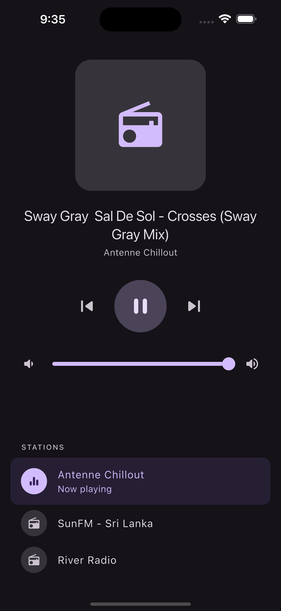
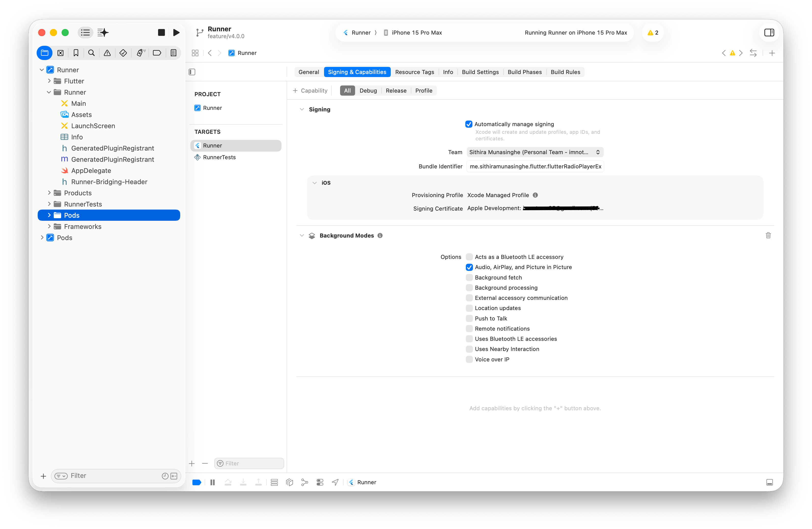

# Flutter Radio Player

[](https://pub.dev/packages/flutter_radio_player)
[](https://pub.dev/packages/flutter_radio_player)
[](https://pub.dev/packages/flutter_radio_player)
[](https://github.com/Sithira/FlutterRadioPlayer/actions/workflows/ci.yml)

A Flutter plugin for playing streaming radio with background playback, lock screen controls, and platform-native media integrations.

<p align="center">
  
</p>

|             | Android | iOS     |
|-------------|---------|---------|
| **Support** | SDK 21+ | iOS 14+ |

## Features

- Background audio playback with no extra configuration
- Lock screen and notification media controls
- ICY/Shoutcast metadata extraction
- Multiple source queue with next/previous/jump-to navigation
- Volume control with stream updates
- Artwork support (asset paths and remote URLs)
- watchOS, WearOS, CarPlay, and Android Auto integration
- Swift Package Manager and CocoaPods support on iOS

## Quick Start

### Installation

```bash
flutter pub add flutter_radio_player
```

### Minimal Example

```dart
import 'package:flutter_radio_player/flutter_radio_player.dart';

final player = FlutterRadioPlayer();

await player.initialize([
  const RadioSource(url: 'https://example.com/stream'),
], playWhenReady: true);
```

## Working with Sources

Define your radio stations using the `RadioSource` model:

```dart
const sources = [
  RadioSource(url: 'https://example.com/stream'),
  RadioSource(
    url: 'https://example.com/jazz',
    title: 'Jazz FM',
    artwork: 'assets/jazz_cover.jpg', // bundled asset
  ),
  RadioSource(
    url: 'https://example.com/rock',
    title: 'Rock Radio',
    artwork: 'https://example.com/rock_cover.png', // remote URL
  ),
];

await player.initialize(sources, playWhenReady: true);
```

| Field     | Type      | Description                          |
|-----------|-----------|--------------------------------------|
| `url`     | `String`  | Stream URL (required)                |
| `title`   | `String?` | Display name for lock screen         |
| `artwork` | `String?` | Asset path or URL for album artwork  |

## Working with Playback Controls

```dart
await player.play();
await player.pause();
await player.playOrPause(); // toggle

// Navigate sources
await player.nextSource();
await player.previousSource();
await player.jumpToSourceAtIndex(2);

// Volume (0.0 to 1.0)
await player.setVolume(0.8);
final volume = await player.getVolume();

// Clean up when done
await player.dispose();
```

## Working with Streams

Listen to real-time player state changes using streams:

### Playback State

```dart
player.isPlayingStream.listen((bool isPlaying) {
  print(isPlaying ? 'Playing' : 'Paused');
});
```

### Now Playing / ICY Metadata

```dart
player.nowPlayingStream.listen((NowPlayingInfo info) {
  print('Now playing: ${info.title}');
});
```

The `nowPlayingStream` automatically extracts ICY metadata from Shoutcast/Icecast streams. If the stream provides metadata (e.g., artist and song title), it will appear here without any extra configuration.

### Volume Changes

```dart
player.volumeStream.listen((VolumeInfo vol) {
  print('Volume: ${vol.volume}, Muted: ${vol.isMuted}');
});
```

## Player State

`FlutterRadioPlayer.instance` is a shared player. `FlutterRadioPlayer()` still works, but every instance drives the same native player, so the shared instance is a convenience, not isolation.

`state` is the latest snapshot of the player and `stateStream` emits a new snapshot on every change. A listener that subscribes to `stateStream` first receives the latest snapshot (if one has arrived), then live updates.

```dart
final player = FlutterRadioPlayer.instance;

StreamBuilder<RadioPlayerState>(
  initialData: player.state,
  stream: player.stateStream,
  builder: (context, snapshot) {
    final state = snapshot.requireData;
    return Text('${state.status.name} - ${state.currentSource?.title}');
  },
);
```

| Field           | Type                | Description                                                 |
|-----------------|---------------------|-------------------------------------------------------------|
| `status`        | `PlaybackStatus`    | See the table below                                         |
| `currentIndex`  | `int?`              | Index of the current source, `null` when nothing is loaded  |
| `currentSource` | `RadioSource?`      | The source at `currentIndex`, `null` when nothing is loaded |
| `nowPlaying`    | `NowPlayingInfo?`   | Track title, `null` when none is known                      |
| `volume`        | `double`            | Playback volume, 0.0 to 1.0                                 |
| `error`         | `RadioPlayerError?` | The pending playback error, `null` when there is none       |

| Status    | Meaning                                                                                  |
|-----------|------------------------------------------------------------------------------------------|
| `idle`    | No sources are loaded, or the player was disposed                                        |
| `loading` | Playback was requested and is not audible yet (connecting or buffering)                  |
| `playing` | Audio is playing                                                                         |
| `paused`  | Sources are loaded and playback was not requested (or is suppressed)                     |
| `error`   | A playback error is pending; cleared by the next `play()` (which retries), source change or `initialize()`   |

`state` is eventually consistent. It reflects the last snapshot received from the native side, not the result of the last call: the future returned by `initialize()` or `play()` completes when the command has been dispatched, not when the state has changed. Read `state` for the initial value and react to `stateStream` afterwards. Before the first snapshot arrives, `state` is an idle state with a volume of 0.5.

### Errors

When `status` is `error`, `state.error` holds a `RadioPlayerError` with a `code` (`RadioPlayerErrorCode`) and a non-empty `message`. There is no automatic retry or reconnect in 4.x. On both platforms a user-initiated `play()` or `playOrPause()` retries the current source, and the state goes `error`, `loading`, then `playing` or back to `error`. Switching source or calling `initialize()` also clears the error.

A source that cannot be played at all behaves the same way: when `initialize()`, `nextSource()`, `previousSource()` or `jumpToSourceAtIndex()` selects it, `currentIndex` moves to that entry, the previous station stops, and the status is `error` (code `invalidSource` on iOS for an unparsable or scheme-less URL, `unknown` on Android in 4.x). `nextSource()`, `previousSource()` and `jumpToSourceAtIndex()` then move on normally, while `play()` retries the invalid entry and fails again.

| Code                                                                 | Emitted in 4.x | Meaning                                      |
|----------------------------------------------------------------------|----------------|----------------------------------------------|
| `invalidSource`                                                      | iOS only       | The source URL is unparsable or has no scheme |
| `network`                                                            | Android, iOS   | A connectivity problem prevented playback    |
| `unknown`                                                            | Android, iOS   | Any other failure; `message` has the details |
| `httpStatus`, `unsupportedFormat`, `backgroundRestricted`, `timeout` | never          | Reserved, not emitted in 4.x                 |

### What `nowPlaying` contains

`state.nowPlaying` keeps the platform behaviour of `nowPlayingStream`, which still differs between the platforms in 4.x:

- Android: `null` for a moment after a source switch, then the source's `title` (if it has one) and later ICY stream titles as they arrive.
- iOS: `null` after a source switch and until the stream sends an ICY title; the source's `title` is not copied into it.

### Legacy streams

`isPlayingStream`, `nowPlayingStream` and `volumeStream` are superseded by `stateStream` and keep working. They are derived from the same snapshots, are shared between listeners, do not replay the latest value to new listeners, and no longer emit the same value twice in a row. `isPlayingStream` emits when `status == playing` changes on Android, and when `status == playing || status == loading` changes on iOS.

### Calls before `initialize()` or after `dispose()`

`play()`, `pause()`, `playOrPause()`, `nextSource()`, `previousSource()` and `jumpToSourceAtIndex()` called before `initialize()` or after `dispose()` are ignored and logged as a warning on both platforms (`adb logcat -s FlutterRadioPlayer:W` on Android, the unified log on iOS). Call `initialize()` first. It does not need to be awaited before the next call: `initialize(sources); play();` starts playback.

`setVolume()` differs by platform:

- iOS: always applied. Before `initialize()` the volume is remembered and used when the player is created.
- Android: ignored and logged as a warning when there is no player, that is before `initialize()` or after `dispose()`. `initialize()` also sets the volume to 0.5, so a volume set before it does not survive.

`getVolume()` returns 0.5 on Android when there is no player.

## Full Example

A complete player widget with play/pause, skip controls, metadata display, and volume slider:

```dart
import 'package:flutter/material.dart';
import 'package:flutter_radio_player/flutter_radio_player.dart';

class RadioPlayerWidget extends StatefulWidget {
  const RadioPlayerWidget({super.key});

  @override
  State<RadioPlayerWidget> createState() => _RadioPlayerWidgetState();
}

class _RadioPlayerWidgetState extends State<RadioPlayerWidget> {
  final _player = FlutterRadioPlayer();
  double _volume = 0.5;

  @override
  void initState() {
    super.initState();
    _player.initialize([
      const RadioSource(
        url: 'https://s2-webradio.antenne.de/chillout?icy=https',
        title: 'Antenne Chillout',
      ),
      const RadioSource(
        url: 'https://radio.lotustechnologieslk.net:2020/stream/sunfmgarden?icy=https',
        title: 'SunFM - Sri Lanka',
      ),
    ], playWhenReady: true);
  }

  @override
  void dispose() {
    _player.dispose();
    super.dispose();
  }

  @override
  Widget build(BuildContext context) {
    return Column(
      mainAxisAlignment: MainAxisAlignment.center,
      children: [
        // Now playing info
        StreamBuilder<NowPlayingInfo>(
          stream: _player.nowPlayingStream,
          builder: (context, snapshot) {
            final title = snapshot.data?.title ?? 'No track info';
            return Text(title, style: Theme.of(context).textTheme.titleLarge);
          },
        ),
        const SizedBox(height: 24),

        // Transport controls
        StreamBuilder<bool>(
          stream: _player.isPlayingStream,
          builder: (context, snapshot) {
            final isPlaying = snapshot.data ?? false;
            return Row(
              mainAxisAlignment: MainAxisAlignment.center,
              children: [
                IconButton(
                  iconSize: 36,
                  onPressed: _player.previousSource,
                  icon: const Icon(Icons.skip_previous_rounded),
                ),
                IconButton(
                  iconSize: 48,
                  onPressed: () => isPlaying ? _player.pause() : _player.play(),
                  icon: Icon(isPlaying ? Icons.pause_rounded : Icons.play_arrow_rounded),
                ),
                IconButton(
                  iconSize: 36,
                  onPressed: _player.nextSource,
                  icon: const Icon(Icons.skip_next_rounded),
                ),
              ],
            );
          },
        ),
        const SizedBox(height: 16),

        // Volume slider
        Row(
          children: [
            const Icon(Icons.volume_down_rounded),
            Expanded(
              child: Slider(
                value: _volume,
                onChanged: (value) {
                  setState(() => _volume = value);
                  _player.setVolume(value);
                },
              ),
            ),
            const Icon(Icons.volume_up_rounded),
          ],
        ),
      ],
    );
  }
}
```

See the [example app](example/) for the full runnable project.

## Platform Setup

### Android

Add the following permissions to your `AndroidManifest.xml`:

```xml
<uses-permission android:name="android.permission.INTERNET" />
<uses-permission android:name="android.permission.FOREGROUND_SERVICE" />
<uses-permission android:name="android.permission.FOREGROUND_SERVICE_MEDIA_PLAYBACK" />
```

> `FOREGROUND_SERVICE` and `FOREGROUND_SERVICE_MEDIA_PLAYBACK` are already declared by the plugin. `INTERNET` must be declared by the host app.

If your radio streams use plain HTTP (not HTTPS), opt in to cleartext traffic. Either add the attribute to your `<application>` tag:

```xml
<application
    android:usesCleartextTraffic="true"
    ...>
```

Or, preferred, whitelist only the streaming domains via a network security config (`res/xml/network_security_config.xml`):

```xml
<network-security-config>
    <domain-config cleartextTrafficPermitted="true">
        <domain includeSubdomains="true">your-stream-host.example.com</domain>
    </domain-config>
</network-security-config>
```

Then reference it from your `<application>` tag: `android:networkSecurityConfig="@xml/network_security_config"`.

### iOS

1. Enable **Audio, AirPlay, and Picture in Picture** under your target's **Signing & Capabilities > Background Modes** in Xcode:



2. If your radio streams use plain HTTP, add the following to your `Info.plist`:

```xml
<key>NSAppTransportSecurity</key>
<dict>
    <key>NSAllowsArbitraryLoads</key>
    <true/>
</dict>
```

3. **Swift Package Manager** is supported alongside CocoaPods (Flutter 3.24+). No additional configuration is needed.

## API Reference

### Methods

| Method                    | Description                            |
|---------------------------|----------------------------------------|
| `initialize(sources)`     | Set sources and optionally auto-play   |
| `play()`                  | Resume playback                        |
| `pause()`                 | Pause playback                         |
| `playOrPause()`           | Toggle play/pause                      |
| `setVolume(double)`       | Set volume (0.0 to 1.0)               |
| `getVolume()`             | Get current volume                     |
| `nextSource()`            | Skip to next source                    |
| `previousSource()`        | Skip to previous source                |
| `jumpToSourceAtIndex(i)`  | Jump to source at index                |
| `dispose()`               | Release player resources               |

### Streams

| Stream / getter    | Type                       | Description                                         |
|--------------------|----------------------------|-----------------------------------------------------|
| `stateStream`      | `Stream<RadioPlayerState>` | State snapshots; new listeners get the latest first |
| `state`            | `RadioPlayerState`         | Latest snapshot (eventually consistent)             |
| `isPlayingStream`  | `Stream<bool>`             | Playback changes (superseded by `stateStream`)      |
| `nowPlayingStream` | `Stream<NowPlayingInfo>`   | Track metadata (superseded by `stateStream`)        |
| `volumeStream`     | `Stream<VolumeInfo>`       | Volume and mute changes (superseded by `stateStream`) |

`FlutterRadioPlayer.instance` is the shared instance.

### Models

| Model            | Fields                                               |
|------------------|------------------------------------------------------|
| `RadioSource`    | `url` (String), `title` (String?), `artwork` (String?) |
| `NowPlayingInfo` | `title` (String?)                                    |
| `VolumeInfo`     | `volume` (double), `isMuted` (bool)                  |
| `RadioPlayerState` | `status`, `currentIndex`, `currentSource`, `nowPlaying`, `volume`, `error` |
| `PlaybackStatus` | `idle`, `loading`, `playing`, `paused`, `error`      |
| `RadioPlayerError` | `code` (`RadioPlayerErrorCode`), `message` (String) |
| `RadioPlayerErrorCode` | `invalidSource`, `network`, `unknown`; reserved: `httpStatus`, `unsupportedFormat`, `backgroundRestricted`, `timeout` |

## Architecture

This is a [federated plugin](https://docs.flutter.dev/packages-and-plugins/developing-packages#federated-plugins) split into four packages:

| Package | Description |
|---------|-------------|
| [`flutter_radio_player`](packages/flutter_radio_player/) | App-facing API |
| [`flutter_radio_player_platform_interface`](packages/flutter_radio_player_platform_interface/) | Shared interface and models |
| [`flutter_radio_player_android`](packages/flutter_radio_player_android/) | Android implementation (Media3/ExoPlayer) |
| [`flutter_radio_player_ios`](packages/flutter_radio_player_ios/) | iOS implementation (AVFoundation) |

Platform communication uses [Pigeon](https://pub.dev/packages/pigeon) for type-safe code generation.

## Migration from v3

See the [Migration Guide](MIGRATION.md) for detailed upgrade instructions.

## Support the Plugin

If you find this plugin useful:

- Give it a star on [GitHub](https://github.com/Sithira/FlutterRadioPlayer)
- Leave a like on [pub.dev](https://pub.dev/packages/flutter_radio_player)
- Buy me a coffee via USDT-TR20: `TNuTkL1ZJGu2xntmtzHzSiH5YdVqUeAujr`

## Contributing

Contributions are welcome. Please open an issue first to discuss what you would like to change.

## License

[MIT](LICENSE)
